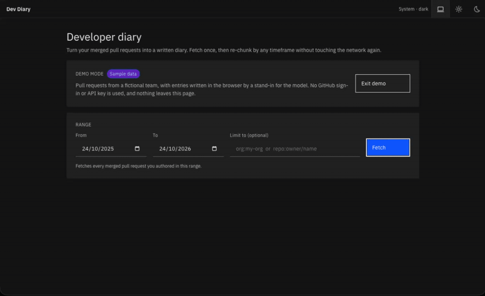

# Dev Diary

**Turn your merged GitHub pull requests into a written developer diary — grouped
by day, week, fortnight, month or quarter.**

**Live demo:** https://dev-diary-murex.vercel.app/ ·
**[Try it with sample data](https://dev-diary-murex.vercel.app/?demo)**, with no
sign-in or API key needed

Built with Next.js 15, React 19, TypeScript, Auth.js (GitHub OAuth), IBM Carbon,
and the OpenAI and Anthropic APIs.

[](https://dev-diary-murex.vercel.app/?demo)

## Why

Performance reviews, promotion cases and CVs all ask the same question: *what did
you actually do this year?* The answer is already sitting in your pull request
history, scattered across hundreds of PRs. Dev Diary fetches them once, groups
them by whatever timeframe you choose, and writes one entry per period that finds
the through-line across the work, rather than summarising each PR on its own.
Each substantial theme is written in **STAR** form (Situation, Task, Action,
Result), the structure reviews and interviews ask for.

## Demo it in two minutes

**With sample data (no account needed).** Open
[`/?demo`](https://dev-diary-murex.vercel.app/?demo), or click **Try with
sample data**. You get six months of pull requests from a fictional team. Diary
entries are written in the browser by a stand-in for the model, so you can try
the whole flow without sending anything anywhere. Then follow steps 3–6 below.

**With your own data.** You need a GitHub account with some merged pull
requests, and an OpenAI (`sk-…`) or Anthropic (`sk-ant-…`) API key.

1. Open the [live demo](https://dev-diary-murex.vercel.app/) and **Sign in with
   GitHub**.
2. Paste an API key. The provider is detected from the key, and the **Model**
   dropdown fills with the current models that key can actually use, newest
   first.
3. Set a date range of **one to three months** and click **Fetch**. Progress
   streams in while it runs. (Longer ranges can hit the hosting time limit; see
   [Limitations](#limitations-and-next-steps).)
4. Switch between **Daily / Weekly / Monthly / Quarterly**. Regrouping happens
   instantly in the browser, with no new network calls.
5. Click **Generate all**. Entries are written three at a time. Switch timeframe
   and generate again: only the new periods are generated, and the rest come
   from cache.
6. **Copy** or **Export .md** to get the diary as plain markdown.

Things worth pointing out during a walkthrough:

- **The API key never reaches the server.** The browser calls the provider
  directly. The key lives in React state, with optional `sessionStorage` if you
  opt in.
- **The GitHub token never reaches the browser.** It's kept in an encrypted,
  http-only cookie, and only the server-side fetch route reads it.
- **Regrouping is free.** Open the network tab and switch timeframe: nothing is
  sent.
- **The theme follows your system.** The header shows which way it's set
  (`System · dark`) and changes live if you switch your OS theme. The sun and
  moon buttons pin light or dark, and that choice is remembered without a flash
  on reload.

## Engineering highlights

**A pipeline in four stages, so cheap steps never rerun expensive ones.** Fetch →
bucket → summarise → render. Bucketing is a pure, synchronous function, which is
why changing granularity costs nothing.

**Working within GitHub's search limits.** The search API allows 30 requests a
minute and never returns more than 1000 results for one query. Requests are
spaced about two seconds apart, with backoff on rate-limit responses. When a date
window holds more than 1000 results, it is split in half recursively until every
piece fits.

**Credentials split across a trust boundary.** The GitHub token is server-only
and never appears in `/api/auth/session` either. The AI key is client-only, so
whoever hosts the app cannot see it.

**Choosing models from the key, not a fixed list.** Providers can limit a key to
some models. Asking the provider which models the key can use turns a confusing
generate-time error ("project does not have access to model X") into a dropdown
that only offers what works. Neither API flags deprecated models, so the list
is sorted newest first by creation date. Dated snapshots are hidden when their
alias is listed, and so are a few generations the vendors have retired. Codex
models are hidden too, because they only work on OpenAI's Responses API.
Models with an announced shutdown are still listed, marked *(deprecated)*. If
those are the only models a key can use, the app says so and explains how to
fix it.

**A demo mode that takes the same code path.** The sample data replaces only the
two outside services: GitHub (with a fetch that streams the same progress
messages) and the model (with a writer that builds each entry from the period's
pull requests, in the structure the real prompt asks for). Grouping, caching,
the concurrency limit and export are the real code. Entries make sense at any
granularity, because they're built from whichever pull requests fall in the
period.

**Theming without a flash.** Carbon's light and dark token sets are tied to
`prefers-color-scheme`, and a `data-theme` attribute can override it. A small
inline script applies a saved choice before first paint.

**A cache key that matches what the content depends on.** Entries are cached
against the model, the period and the ids of the PRs in it. Refetching only
invalidates the periods whose PRs actually changed.

**One model call per period, not per PR.** It's cheaper, and the result is
better: a month's entry can describe themes that no single PR shows.

**STAR entries that flag gaps instead of filling them.** Each substantial theme
becomes a Situation / Task / Action / Result highlight, and smaller work goes
under *Also shipped*. Every line has to be backed by the PRs. When they don't
state an outcome, the entry says *"Not stated in the pull requests. Add the
measured outcome."* instead of inventing one. A flagged gap is something you can
fill in before a review, while an invented result is a liability. The rules came
from checking generated entries line by line against their source PRs. That
review caught results that only restated the work, a measured figure (9.3 kB of
CSS instead of 91 kB) that a 1200-character description limit had cut off, and
housekeeping PRs reported as achievements. The heading, the counts and the PR
list are built in code rather than asked of the model, so they're always
accurate and cost no output tokens.

**Progress streamed over a long request.** The fetch route sends newline-delimited
JSON, so the UI shows live progress during a fetch that takes minutes.

## Privacy

Generating an entry sends the **titles and descriptions** of that period's PRs to
your chosen provider. Diffs, file contents and commit messages are never sent.
For work repositories, check that sending PR descriptions is allowed under your
organisation's policy. Fetching and grouping make no model calls at all.

## Limitations and next steps

Recorded on purpose. Each one comes with the fix I'd make next.

| Limitation | Next step |
| --- | --- |
| A long fetch (for example, twelve months across many repos) can go past Vercel's 60s function limit. | Have the client request one date window per call instead of the whole range in one. |
| Periods with more than 60 PRs are summarised from the 60 most recent. Descriptions share a 24,000-character budget, so in a busy period each is cut to as little as 800 characters. | Summarise in stages: chunk first, then combine. |
| Request pacing (`lastSearchAt` in `lib/github.ts`) is shared by the whole process, so concurrent users throttle each other. | Pace per token, using a shared store. |
| Tests cover bucketing and provider selection, but not the fetcher's pagination, window splitting or backoff. | Add tests against a mocked GitHub API. |
| OAuth Apps can't ask for read-only `repo` access, so sign-in grants more than the app uses. | Move to a GitHub App with read-only repository permissions. |
| The lists of retired and deprecated model generations are maintained by hand, because neither models API reports deprecation. | Use deprecation data from the providers if they ever publish it. |

## Run it locally

```bash
npm install
cp .env.example .env.local
npm run dev
```

Then register a GitHub OAuth App at https://github.com/settings/developers:

```
Homepage URL:               http://localhost:3000
Authorization callback URL: http://localhost:3000/api/auth/callback/github
```

and fill in `.env.local`:

```
AUTH_SECRET=          # npx auth secret
AUTH_GITHUB_ID=
AUTH_GITHUB_SECRET=
```

To deploy, use your deployed origin in place of `localhost:3000`, both in the
OAuth App and in your environment. For organisations with SAML SSO, the OAuth App
also has to be authorised for that organisation. Otherwise its repositories
silently return no results.

Checks:

```bash
npm run typecheck
npm test
npm run build
```

### CLI

The CLI uses the same `lib/` code to fetch, group and write entries, and saves
the diary as a markdown file. Add these to `.env`:

```
GITHUB_TOKEN=          # fine-grained, read-only token is best
AI_API_KEY=            # sk-… (OpenAI) or sk-ant-… (Anthropic)
SINCE_DATE=2025-09-01
UNTIL_DATE=            # optional, defaults to today
SCOPE=                 # optional, e.g. org:foo or repo:owner/name
GRANULARITY=month      # day | week | fortnight | month | quarter
MODEL=                 # optional, defaults to a cheap model the key can use
OUTPUT=developer-diary.md
```

```bash
npm run dev-diary
```

## Project layout

```
app/
  api/auth/[...nextauth]/  Auth.js route handlers
  api/pull-requests/       Server-side fetch; holds the OAuth token, streams NDJSON progress
  page.tsx                 The single-page UI and its state
auth.ts                    Auth.js config; the token is kept off the session object
components/                UI, built on @carbon/react
lib/
  github.ts                Paced, paginated search with recursive window splitting
  buckets.ts               Grouping by timeframe (pure, synchronous)
  providers.ts             OpenAI and Anthropic behind one interface; detects provider from the key
  summarise.ts             One entry per period; cache key; concurrency limit
  prompts.ts               System prompt and the prompt for each period
  theme.ts                 Theme choice and the script that applies it before paint
  demo.ts                  Sample pull requests and the stand-in writer for demo mode
  fetch-client.ts          Reads the streamed response
  __tests__/               Unit tests (Vitest)
scripts/dev-diary.ts       CLI entry point
```
